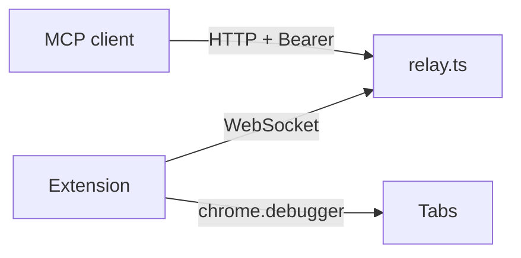

# BrowserMCP

Use your own logged-in Chrome or Edge as a remote MCP server. Any MCP client can open tabs, click, type, read pages, take screenshots and record video in the browser you already use, with your sessions and cookies.



- **Extension** (Manifest V3): connects out to the relay and drives tabs through the Chrome DevTools Protocol, with real mouse and keyboard events.
- **Relay** (one Node file): MCP server over Streamable HTTP. Binds to localhost; reach it through a tunnel.

## Features

- **Mostly compatible with Claude in Chrome.** Tool names, schemas and descriptions follow the Claude in Chrome extension, so Claude models use them the way they already know.
- **Works in the background.** The browser never takes focus. Tabs are driven while covered by other windows or while another tab is in front.
- **Starts the browser on demand.** With `BROWSER_LAUNCH` set, the relay opens the browser when a call arrives and none is connected.
- **Batching.** `browser_batch` runs clicks, typing, JavaScript and screenshots in one round trip.
- **Iframes included.** `read_page` and `find` see into iframes, cross-origin too.
- **Extras.** Console and network inspection, video recording, downloads and PDF export.
- **No LLM inside.** `find` is keyword matching; no API key is needed.

## Tools

| Tool | Purpose |
|---|---|
| `tabs_context_mcp`, `tabs_create_mcp`, `tabs_close_mcp` | The "MCP" tab group the model works in |
| `navigate` | Open a URL, go back or forward |
| `computer` | Screenshot, zoom, click, type, key, scroll, drag, hover, wait |
| `browser_batch` | Several tool calls in one round trip |
| `read_page`, `find`, `get_page_text` | Accessibility tree with `ref_N` ids, element search, page text |
| `javascript_tool` | Run JavaScript in the page |
| `form_input`, `file_upload` | Set a form control or a file input by ref |
| `inspect` | Console, errors, network, cookies, storage |
| `record` | WebM video of a tab, or a series of frames |
| `files` | Download a URL, list downloads, print a tab to PDF |

The last three are not part of Claude in Chrome.

## Quick start

Needs Node 22.18+ and Chrome or Edge 125+.

```sh
npm install
npm run build
```

Load the extension: open `chrome://extensions` (or `edge://extensions`), enable Developer mode, choose Load unpacked and pick the `extension/` folder.

Start the relay:

```sh
export RELAY_TOKEN=$(openssl rand -hex 32)
echo $RELAY_TOKEN
node relay.ts        # 127.0.0.1:8787, PORT overrides
```

Open the extension popup, enter `http://127.0.0.1:8787` and the token, press Connect.

### Start the browser on demand

Set `BROWSER_LAUNCH` to a shell command and the relay runs it when a call arrives while no browser is connected, then waits up to 20s for the extension:

```sh
BROWSER_LAUNCH='open -g -a "Google Chrome"' node relay.ts     # macOS, opens without taking focus
BROWSER_LAUNCH='google-chrome' node relay.ts                   # Linux
BROWSER_LAUNCH='start msedge' node relay.ts                    # Windows
```

The extension must be installed in the profile that opens and have been left connected; it reconnects by itself at browser start. The machine has to be awake with a desktop session: the relay cannot wake a sleeping computer.

Expose the relay with a tunnel:

```sh
cloudflared tunnel --url http://127.0.0.1:8787
# or
ngrok http 8787
```

### Private access with Tailscale

A public tunnel is not needed when both machines are on your tailnet. This suits a Claude Code session on a cloud machine that drives the browser on your laptop, for example to test a web app.

On the machine with the browser (relay running, extension connected):

```sh
tailscale serve --bg 8787
tailscale serve status      # prints https://YOUR-MACHINE.YOUR-TAILNET.ts.net
```

This publishes the relay over HTTPS to your tailnet only. It needs MagicDNS and HTTPS certificates enabled in the Tailscale admin console.

On the cloud machine:

```sh
curl -fsSL https://tailscale.com/install.sh | sh
sudo tailscale up --authkey tskey-auth-XXXX     # an ephemeral key fits short-lived machines

claude mcp add --transport http browser https://YOUR-MACHINE.YOUR-TAILNET.ts.net/mcp \
  --header "Authorization: Bearer $RELAY_TOKEN"
```

In a container without a TUN device, run `tailscaled --tun=userspace-networking --outbound-http-proxy-listen=localhost:1055 &` and start Claude Code with `HTTPS_PROXY=http://localhost:1055`.

Stop sharing with `tailscale serve reset`. The token is still required: Tailscale limits who can reach the relay, the token decides who may use it.

Paths given to `file_upload` are read on the browser machine, not the cloud machine.

## Connect a client

Claude Code:

```sh
claude mcp add --transport http browser https://YOUR-TUNNEL/mcp \
  --header "Authorization: Bearer $RELAY_TOKEN"
```

Cursor (`~/.cursor/mcp.json`):

```json
{
  "mcpServers": {
    "browser": {
      "url": "https://YOUR-TUNNEL/mcp",
      "headers": { "Authorization": "Bearer YOUR_TOKEN" }
    }
  }
}
```

## Differences from Claude in Chrome

- `find` matches keywords against roles and accessible names instead of using a language model.
- `tabs_context_mcp` also lists `otherTabs`, the tabs you already have open. Any tab can be controlled; only group tabs can be closed.
- `javascript_tool` returns up to 25,000 characters and gives up after 45s.
- `save_to_disk` returns a relay URL instead of a local path.
- There are no per-site permission prompts. The relay logs every call with its `action_summary`.
- `form_input` and `file_upload` follow the original conventions but their schemas are our own.

## Good to know

- **Security.** The token gives full control of your browser sessions. Keep it secret and stop the tunnel when idle.
- **Files.** Recordings, PDFs and saved screenshots are stored in `./files` and served at `/files/...`. Fetch them with the Bearer header or `?token=`. Downloads are served from the browser's download folder, so the relay must run on the same machine as the browser.
- **Debugging bar.** The browser shows "debugging this browser" while a tab is controlled.
- **Presence.** A controlled tab is told it is focused and visible, so sites see you as active while it is attached.
- **Dialogs.** `alert`, `confirm` and `prompt` are accepted automatically and logged in `inspect` console.
- **Coordinates** are in the frame reported with each screenshot (longest side at most 1568 px), not CSS pixels.
- **Limits.** `chrome://`, `edge://` and extension store pages cannot be controlled. One browser per relay. Recordings are WebM without a duration header (`ffmpeg -i in.webm -c copy out.webm` adds it).

## Development

```sh
npm run check        # type-check relay and extension
npm run build        # compile extension/src to extension/dist
```

After changing extension code, rebuild and press reload on the extensions page.
